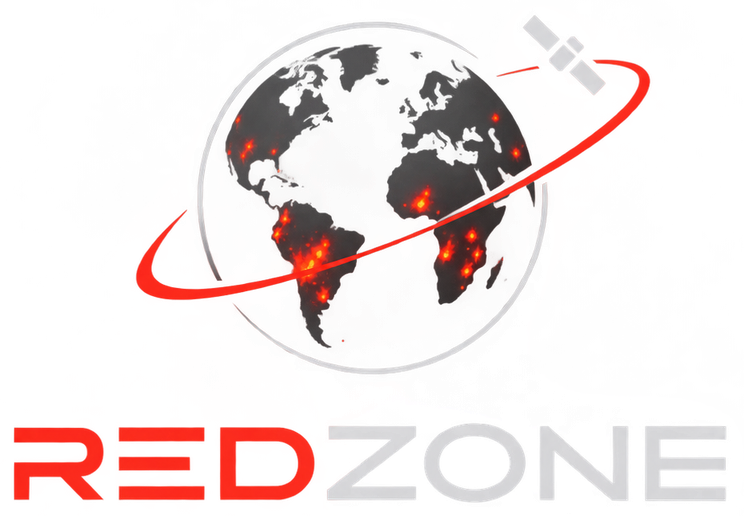

<p align="center">
  
</p>

<p align="center">
  <b>A global active-fire map built on NASA FIRMS satellite data — MODIS and VIIRS, harmonized but never mixed.</b><br>
  NASA Space Apps Challenge project · open source (MIT)
</p>

<p align="center">
  <a href="https://github.com/joekwn/REDZONE/actions/workflows/tests.yml"></a>
  <a href="LICENSE"></a>
  
</p>

---

REDZONE shows where satellites detected active fires, how recent and how confident each detection
is, and what the fire weather looks like for the coming week. It combines **MODIS C6.1** (Terra/Aqua)
and **VIIRS 375 m NOAA-21** detections in one map while keeping the two sensors scientifically
separate.

> **Not a warning or safety service.** Satellites miss fires and sometimes detect things that are
> not fires. For emergencies, follow your local authorities. See [Terms](webapp/static/terms.html).

## Features

- **Map** of detections (grouped into grid cells when zoomed out, individual points when zoomed in), filters by
  date, sensor, confidence; polar and unusable-FRP rows hidden by default but never deleted.
- **Live updates** from the FIRMS API every 3 hours, using exactly the same cleaning rules as the research data.
- **Statistics** per sensor family (no cross-sensor sums of FRP).
- **Near me**: detections around your location (browser location or IP-based guess).
- **7-day fire-weather outlook** (Fosberg index + rain + local fire history).
- **Watched sites** with alerts, and **events** that get a safety check 12 hours before they start.
- **Look up older data** for any area (fetched on demand from FIRMS, not stored).
- **Accounts**: Argon2id password hashing, hashed session tokens, CSRF protection, rate limits, lockout.
- **Search bar** for places, resizable sidebar, light on dependencies (plain HTML + Leaflet + Chart.js).

## The science in one minute

- **Research set:** 1 Nov 2025 – 1 Nov 2026, **21,167,202 detections**. All rules were developed and tested on it.
- **Harmonized:** one table, shared column names, UTC timestamps, `sensor_family` on every row.
- **Flagged, not deleted:** `frp_flag`, `frp_usable`, `polar_flag`; rejected rows are saved with a reason.
- **FRP calibration between sensors was tested and rejected:** matchups at 0.1° and 0.25°, OLS / RMA / Deming
  fits, validated on held-out weeks — not reliable enough, so REDZONE never converts or sums FRP across sensors.

Full details: **[docs/SCIENCE.md](docs/SCIENCE.md)**.

## Quick start (your computer)

You need **Python 3.11+** and a free **[NASA FIRMS map key](https://firms.modaps.eosdis.nasa.gov/api/map_key/)**.
The 21-million-row research database is not in this repository (too large), so you start with an
empty one and fill it with recent real data.

```bash
git clone https://github.com/joekwn/REDZONE.git
cd REDZONE
python -m pip install -r requirements.txt

python scripts/init_db.py                     # creates an empty data/redzone.duckdb
```

Set your key (PowerShell: `$env:FIRMS_MAP_KEY = "your-key"`, bash: `export FIRMS_MAP_KEY=your-key`), then:

```bash
python scripts/firms_live.py --start 2026-11-08 --end 2026-11-15   # last few days, worldwide
python -m uvicorn webapp.server:app --port 8000
```

Open **http://127.0.0.1:8000**. On Windows, use `py` instead of `python`.

To make yourself admin (update now, past-data tools), set `REDZONE_ADMIN_EMAILS` to the email you
register with, before starting the server. All settings: [.env.example](.env.example).

## Put it online

| Option | Good for | Guide |
|---|---|---|
| Own server (e.g. Oracle Cloud Always Free) + free `sslip.io` / DuckDNS name | the full site, 24/7 | [docs/DEPLOY.md](docs/DEPLOY.md) |
| Vercel + MotherDuck + GitHub Actions schedule | free hosting from this repo | [docs/VERCEL.md](docs/VERCEL.md) |
| Cloudflare quick tunnel from your laptop | quick demos | [docs/DEPLOY.md](docs/DEPLOY.md#b-cloudflare-quick-tunnel-demo-from-your-laptop) |

## How it works

```
NASA FIRMS API ──► scripts/firms_live.py ──► redzone_rules.harmonize() ──► DuckDB "fires" table
   (every 3 h)        (download + log)        (same rules as research)        (local file or MotherDuck)
                                                                                    │
Open-Meteo, Photon/Nominatim ◄──── webapp/server.py (FastAPI) ◄────────────────────┘
                                         │
                                         ▼
                    webapp/static/*.html (Leaflet map, Chart.js, no build step)
```

## Repository layout

| Path | What it is |
|---|---|
| `webapp/server.py` | FastAPI app: map data, statistics, outlook, sites, events, admin, cron endpoints |
| `webapp/auth.py` | accounts, sessions, rate limits |
| `webapp/lookup.py` | on-demand look-ups of older FIRMS data |
| `webapp/static/` | welcome page, map app, privacy and terms pages, logos |
| `scripts/redzone_rules.py` | **the harmonization and cleaning rules** (shared by everything) |
| `scripts/firms_live.py` | live FIRMS updates (also a command-line tool) |
| `scripts/firms_backfill.py` | collect past data for a date range |
| `scripts/outlook.py` | fire-weather outlook |
| `scripts/notify.py` | alerts, events, email (optional SMTP) |
| `scripts/redzone_db.py` | opens the database (local file or MotherDuck) |
| `scripts/init_db.py` | creates an empty database |
| other `scripts/*.py` | the research pipeline (audit → harmonize → clean → build → calibrate), see below |
| `deploy/` | server setup (systemd, Caddy, backups, updates) |
| `tests/` | automated tests (no internet or FIRMS key needed) |
| `docs/` | science notes and deployment guides |

### Research pipeline (how the 21-million-row database was built)

Run on the original FIRMS archive files, in this order:

1. `audit_parquet_schemas.py`, `inspect_version_type_values.py` — check every file's columns and value formats
2. `harmonize_fire_data.py` — apply the shared rules, one schema for both sensors
3. `check_harmonized_duplicates.py`, `check_data_quality.py`, `inspect_flagged_rows.py` — duplicates and quality checks
4. `clean_fire_data.py` — add flags (`frp_flag`, `frp_usable`, `polar_flag`)
5. `build_database.py`, `add_confidence_classes.py` — build the DuckDB database
6. `find_frp_matchups.py`, `explore_frp_matchups.py`, `fit_frp_calibration.py`, `save_frp_calibration_notes.py` — FRP calibration study

These need `requirements-analysis.txt` (adds pyarrow and matplotlib).

## Development

```bash
python -m pip install -r requirements-dev.txt
python -m pytest
```

Tests use a temporary empty database and a fake FIRMS API, so they need no key and no internet.
They run automatically on every push (GitHub Actions). See [CONTRIBUTING.md](CONTRIBUTING.md).

## Security

Passwords are hashed with Argon2id; only SHA-256 hashes of session tokens are stored; cookies are
HttpOnly and SameSite; every state-changing request needs an anti-CSRF header; sign-in, sign-up and
look-ups are rate limited. Keys and tokens are read from environment variables only — never commit them.
Found a problem? See [SECURITY.md](SECURITY.md).

## Data sources and acknowledgements

We acknowledge the use of data from NASA's **Fire Information for Resource Management System
(FIRMS)** ([firms.modaps.eosdis.nasa.gov](https://firms.modaps.eosdis.nasa.gov)), part of NASA's
Earth Science Data and Information System (ESDIS).

- MODIS C6.1 NRT (MCD14DL): doi:[10.5067/FIRMS/MODIS/MCD14DL.NRT.0061](https://doi.org/10.5067/FIRMS/MODIS/MCD14DL.NRT.0061)
- MODIS C6.1 standard (MCD14ML): doi:[10.5067/FIRMS/MODIS/MCD14ML](https://doi.org/10.5067/FIRMS/MODIS/MCD14ML)
- VIIRS NOAA-21 375 m NRT (VJ214IMGTDL_NRT): doi:[10.5067/VIIRS/VJ214IMG_NRT.002](https://doi.org/10.5067/VIIRS/VJ214IMG_NRT.002)
- Weather: [Open-Meteo](https://open-meteo.com) (CC BY 4.0)
- Place search: [Photon](https://photon.komoot.io) and [Nominatim](https://nominatim.org), data © [OpenStreetMap contributors](https://www.openstreetmap.org/copyright) (ODbL)
- Base maps: © OpenStreetMap contributors, © [CARTO](https://carto.com/attributions), Esri
- Libraries: [Leaflet](https://leafletjs.com), [Chart.js](https://www.chartjs.org), [FastAPI](https://fastapi.tiangolo.com), [DuckDB](https://duckdb.org), [pandas](https://pandas.pydata.org), [argon2-cffi](https://argon2-cffi.readthedocs.io)

Built for the **NASA Space Apps Challenge**. NASA does not endorse this project.

## License

[MIT](LICENSE) for the code. Data keeps the terms of its providers (listed above).
If you use REDZONE in research, please cite it ([CITATION.cff](CITATION.cff)) and the FIRMS products.
